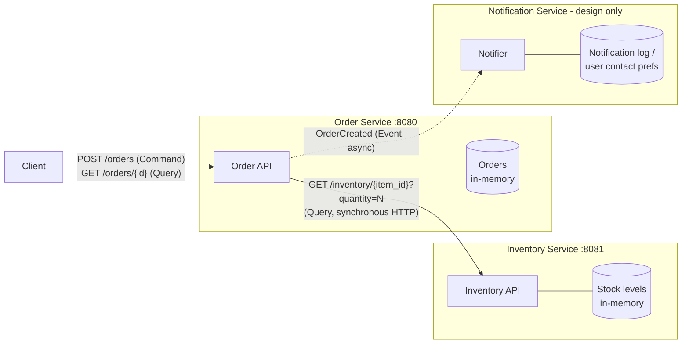

# Online Store: Order / Inventory / Notification (Go)

A small online store split into services. Order and Inventory run as two separate Go processes and talk over HTTP/JSON. Notification is only in the design (it would listen for an `OrderCreated` event). The assignment only asks for the Order -> Inventory call, so I didn't implement it.

| Binary | Port | Role |
|---|---|---|
| `cmd/order` | 8080 | Order Service: `POST /orders` (create), `GET /orders/{id}` (track) |
| `cmd/inventory` | 8081 | Inventory Service: `GET /inventory/{item_id}?quantity=N` (availability) |

Seed stock is `widget=10`, `gadget=0`, `gizmo=3`, all in memory. The Order Service reads `INVENTORY_ADDR` (default `localhost:8081`) and gives up on Inventory after 2s.

## Install and run

You need Go 1.24+. Everything uses the standard library, so there's nothing else to install.

```bash
# terminal 1
go run ./cmd/inventory
# terminal 2
go run ./cmd/order
# terminal 3
curl -i -X POST localhost:8080/orders -H 'Content-Type: application/json' -d '{"item_id":"widget","quantity":2}'
curl -i localhost:8080/orders/ord-1
```

Tests: `go test ./...`

`scripts/demo.sh` runs the whole thing end to end (success, unavailable item, Inventory stopped, Inventory restarted). Its output is saved in [`evidence/demo.txt`](evidence/demo.txt).

## Architecture



Solid arrows are implemented. The dashed one is the planned event. In a real system it would go through a message broker so Order doesn't need to know who's listening.

### Responsibilities and data ownership

| Component | Responsibility | Owns |
|---|---|---|
| Order Service | Validates order requests, asks Inventory if the item is available, creates the order, and lets clients look it up. | Orders: id, item, quantity, status (`store.Orders`) |
| Inventory Service | Says whether a quantity of an item is in stock. | Items and stock levels (`store.Inventory`) |
| Notification Service (design) | Tells the user their order was created. Only reacts to events; the client never calls it. | Notification history and user contact preferences |

Only the owning service reads or writes its data. Order never touches the stock map, it asks Inventory through the API, and Inventory doesn't know orders exist.

### Why these boundaries

Each service maps to one part of the business that changes for its own reasons. Order rules (validation, order states) change separately from stock rules (restocking, warehouses) and from how users get contacted (email, SMS). Giving each piece of data one owner also means there's no shared database and no chance of two services disagreeing on a stock count.

The services also need different kinds of communication. Order can't answer the client until it hears back from Inventory, so that call is a synchronous query. Order doesn't have to wait for a notification to go out, so Notification gets an event instead, and a notification outage can't block orders. Running them as separate processes means Inventory going down only breaks order creation (with a 503), not the Order process itself.

## Command, Query, and Event

| Interaction | Type | Why |
|---|---|---|
| Check whether an item is available | Query | It only reads data. Asking twice gives the same answer and changes nothing. Implemented as `GET /inventory/{item_id}?quantity=N`. |
| Create an order | Command | It asks one specific service (Order) to change state by storing a new order, and Order can accept or reject it (201 / 409 / 404 / 503). Implemented as `POST /orders`. |
| Order was created | Event | It reports something that already happened, so it's in the past tense. Anyone interested (Notification, maybe analytics later) can listen, and the publisher doesn't wait for a reply. Designed as `OrderCreated`, not implemented. |

## Status mapping

| Situation | Inventory returns | Order returns |
|---|---|---|
| Enough stock | 200 `available: true` | 201 `created` |
| Not enough stock | 200 `available: false` | 409 `rejected` |
| Unknown item | 404 | 404 `rejected` |
| Bad input to Order | n/a | 400 |
| Inventory not running | connection refused | 503 `inventory service unavailable` |
| Inventory too slow (>2s) | client timeout | 504 |

## Successful request

```
$ curl -X POST localhost:8080/orders -H 'Content-Type: application/json' -d '{"item_id":"widget","quantity":2}'
{"status":"created","detail":"item available","order":{"id":"ord-1","item_id":"widget","quantity":2,"status":"created"}}
HTTP 201

$ curl localhost:8080/orders/ord-1
{"id":"ord-1","item_id":"widget","quantity":2,"status":"created"}
HTTP 200
```

Behind that, Order called `GET localhost:8081/inventory/widget?quantity=2` and got back:

```
{"item_id":"widget","quantity":2,"available":true,"stock":10}
```

Unavailable items:

```
$ curl -X POST localhost:8080/orders -d '{"item_id":"gadget","quantity":1}'
{"status":"rejected","detail":"item unavailable"}
HTTP 409

$ curl -X POST localhost:8080/orders -d '{"item_id":"nope","quantity":1}'
{"status":"rejected","detail":"unknown item"}
HTTP 404
```

## Failure test: Inventory Service stopped

`scripts/demo.sh` kills the Inventory process and then submits another order. Full output is in [`evidence/demo.txt`](evidence/demo.txt).

```
== 3. inventory service stopped ==
inventory service PID 11351 stopped
$ curl -X POST localhost:8080/orders -d '{"item_id":"widget","quantity":2}'
{"status":"error","detail":"inventory service unavailable, try again later"}
HTTP 503
== 4. order service still running ==
order service PID 11352 alive
$ curl -X POST localhost:8080/orders -d '{"item_id":"widget","quantity":0}'
{"status":"error","detail":"item_id and positive quantity required"}
HTTP 400
== 5. inventory restarted, orders succeed again ==
$ curl -X POST localhost:8080/orders -d '{"item_id":"widget","quantity":2}'
{"status":"created","detail":"item available","order":{"id":"ord-2","item_id":"widget","quantity":2,"status":"created"}}
HTTP 201
```

Order Service log:

```
2026/10/19 14:58:15 order service on :8080 -> http://localhost:8081
2026/10/19 14:58:16 order ord-1 created: "widget" x2
2026/10/19 14:58:16 order "widget" x2: inventory unavailable: Get "http://localhost:8081/inventory/widget?quantity=2": dial tcp [::1]:8081: connect: connection refused
2026/10/19 14:58:17 order ord-2 created: "widget" x2
```

When the HTTP client gets "connection refused", Order logs it and returns a 503 instead of crashing, and it doesn't create an order it couldn't check. I picked 503 because the problem is temporary and on the server side, and the message says which service failed. The Order process (same PID) keeps answering requests, and once Inventory comes back, orders work again without restarting Order (`ord-2`). The unit test `TestOrderInventoryDown503AndHandlerSurvives` checks the same thing.

## Reflection

Clear boundaries let each service be built, deployed, and scaled on its own, since other services only depend on its API and not its internals. When each piece of data has exactly one owner, there's one source of truth, so Order can't accidentally mess up stock levels and Inventory can change how it stores items without breaking Order. Boundaries also limit how far a failure spreads. In my failure test, losing Inventory only made order creation return a 503, the Order process stayed up, and everything recovered once Inventory restarted. Without clear ownership, services start sharing databases and reaching into each other's state, which gets you the tight coupling of a monolith plus network failures on top.
